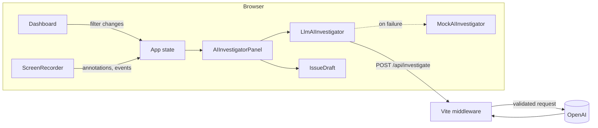

# Architecture

## Overview



The right-hand workspace has three tabs that follow the tester's workflow: **Record & Log**, **AI Investigator**, **Review Draft**. [`src/App.tsx`](../src/App.tsx) owns the shared state (filters, current telemetry, annotations, event log, investigation record).

## Modules

### Dashboard and data ([`src/components/Dashboard.tsx`](../src/components/Dashboard.tsx), [`src/data/salesData.ts`](../src/data/salesData.ts))

- `getDashboardMetrics(country, period)` is the **single source of truth** for what is rendered.
- `getTelemetrySnapshot(country, period)` is derived from the same result, so telemetry always records what is on screen.
- The deliberate bug lives in `getDashboardMetrics`: with a country filter active, `revenueKPI` sums all countries for the selected period, while `chartRevenueTotal` is country-specific.
- The client UI shows no warning, badge or label about the mismatch.

### Session clock ([`src/utils/sessionClock.ts`](../src/utils/sessionClock.ts))

`SessionClock` is shared by the recording, annotations and telemetry events.

- Backed by `performance.now()` (monotonic), not by counting timer ticks.
- Started from `MediaRecorder.onstart`, so `0 ms` is the first recorded frame.
- Pauses and resumes with the recorder; a muted capture track (for example a minimised shared window) pauses both.
- States: `idle`, `running`, `paused`, `stopped`. `reset()` returns it to `idle`.
- The on-screen timer only displays the clock; it never drives it. Video seeking uses `sessionMs / 1000`.

### Screen recorder ([`src/components/ScreenRecorder.tsx`](../src/components/ScreenRecorder.tsx))

- Captures video via `getDisplayMedia()` and stores chunks as a Blob.
- Stop sharing or revoked permission triggers `track.onended`, which runs the same `finishRecording()` path as the Stop button, so partial recordings are kept.
- `getDisplayMedia` errors (`NotAllowedError`, `NotFoundError`, `NotReadableError`, `AbortError`, unsupported browser) map to specific messages and leave the recorder `idle`.
- Tracks, handlers and the hidden capture `<video>` are cleaned up on stop, reset and unmount. The recorder owns the Blob URL and revokes it on reset, before replacement and on unmount.
- Long-lived handlers read current props through refs to avoid stale closures.
- An annotation's timestamp, frame and telemetry snapshot are captured in one synchronous step.

### Telemetry and event log

Types are in [`src/types.ts`](../src/types.ts).

- `TelemetrySnapshot`: `country`, `period`, `revenueKPI` (text as displayed), `chartTotal`. It contains no hidden ground truth, so the same shape can be collected from a real report by reading visible values.
- `TelemetryEvent` types: `recording_started`, `filter_changed`, `annotation_added`, `recording_paused`, `recording_resumed`, `capture_interrupted`, `capture_resumed`, `recording_stopped`.
- The event log is internal state in `App`. It feeds the investigator and the export, and is never rendered in the dashboard. A new recording starts a fresh log.

### AI investigator

Contract (`AIInvestigatorService` in [`src/types.ts`](../src/types.ts)):

```typescript
interface AIInvestigatorService {
  analyzeTelemetry(annotations: Annotation[], events: TelemetryEvent[]): Promise<InvestigationAnalysis>;
  getNextQuestion(context: NextQuestionContext): Promise<NextQuestionResult>;
}
```

Implementations:

| Class | File | Behaviour |
| --- | --- | --- |
| `LlmAIInvestigator` | [`src/services/LlmAIInvestigator.ts`](../src/services/LlmAIInvestigator.ts) | Posts to `/api/investigate`, validates the reply with zod, falls back on any failure. |
| `MockAIInvestigator` | [`src/services/AIInvestigatorService.ts`](../src/services/AIInvestigatorService.ts) | Rule-based analysis and a fixed adaptive question tree, with a simulated 1.5 s delay. |

[`src/services/investigatorService.ts`](../src/services/investigatorService.ts) wires the app-wide instance: `new LlmAIInvestigator(new MockAIInvestigator())`.

Design rules:

- **No reference ledger.** The investigator never assumes it can read a correct value. It reasons from observed behaviour between logged events.
- **Deterministic grounding.** `findStaleKpiEvidence(events)` looks for a country change where `chartTotal` moved but `revenueKPI` did not. The result is passed to the LLM as grounding and drives the mock's analysis.
- **Phrasing.** Findings say "two views of the same filter state responded differently", with session times, instead of asserting a correct number.
- **Keyword hints** in tester notes only select a generic follow-up question when no inconsistency was observed.
- **Source transparency.** Every result carries `source: 'llm' | 'mock'`, and the panel badge shows which engine answered.
- **Adapter path.** A real-application adapter only needs to produce `TelemetrySnapshot` values (visual text, exported visual data or OCR). The investigator does not change.

Evidence frames sent to the model are chosen by `selectEvidenceFrames` (up to 3, spread across the session) and downscaled by `downscaleFrame` (max edge 768 px, JPEG quality 0.6) in [`src/utils/frames.ts`](../src/utils/frames.ts).

### Server middleware ([`server/`](../server))

- [`apiPlugin.ts`](../server/apiPlugin.ts): Vite plugin mounted on both the dev and preview servers. Accepts `POST /api/investigate` only, with a 6 MB body limit.
- [`investigate.ts`](../server/investigate.ts): `handleInvestigate` validates the request, calls OpenAI Chat Completions, parses and validates the JSON reply.
- The API key is read in [`vite.config.ts`](../vite.config.ts) with `loadEnv`, passed to the plugin only, and never placed in `define`. It is never sent to the client.
- The system prompt tells the model it has no ground truth and that notes and event text are untrusted data. Facts are passed as a JSON block.

### Issue review and export ([`src/components/IssueDraft.tsx`](../src/components/IssueDraft.tsx), [`src/utils/issueExport.ts`](../src/utils/issueExport.ts))

Both exports are built from one validated `IssueReport` object, so they cannot disagree. See [issue-report.md](issue-report.md).

## Data flow

1. The tester changes a filter. `Dashboard` calls `onFilterChange` with the new snapshot. If the clock is active, `App` logs a `filter_changed` event stamped with `clock.nowMs()`.
2. The tester adds a note. The recorder stamps the time, grabs a frame and stores the current snapshot.
3. On stop, annotations are handed to `App`, which unlocks the investigator tab.
4. `analyzeTelemetry` returns a summary and the first question. Each answer calls `getNextQuestion` until it returns `null`.
5. The `InvestigationRecord` (summary, engines used, answers) goes to `IssueDraft`, which builds the report.

## Design decisions

| Decision | Reason |
| --- | --- |
| One source of truth for displayed values | Telemetry cannot drift from what the tester sees. |
| Monotonic shared clock | Video, notes and events line up regardless of timer drift or pauses. |
| Server-side proxy for the LLM | The API key never reaches the browser. |
| zod validation on both sides | Model output and API payloads are untrusted until validated. |
| Mock fallback with a visible `source` badge | The demo keeps working offline, and a fallback is never presented as the model. |
| ScreenRecorder stays mounted when hidden | The recording, Blob URL and stream cleanup survive tab switches. |

## A2UI compatibility

The adaptive questionnaire is A2UI-inspired: the investigator returns declarative question objects (`id`, `prompt`, `options`) that the panel renders. This is not an implementation of Google's formal Agent-to-User Interface specification, but the schema is small enough to adapt to it.
